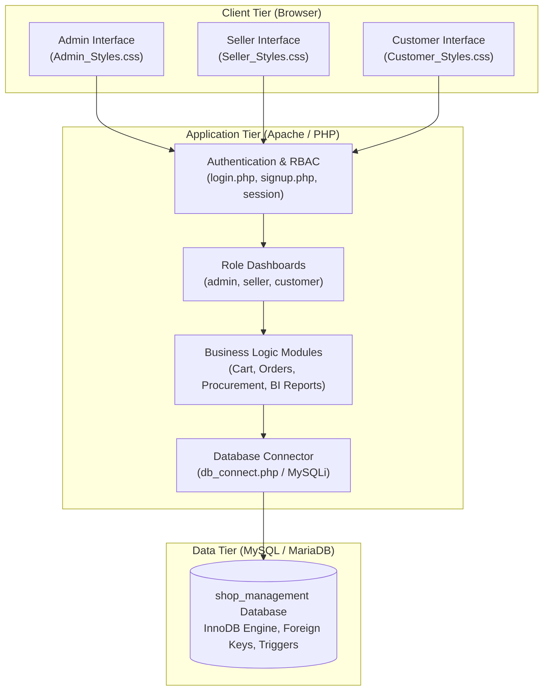
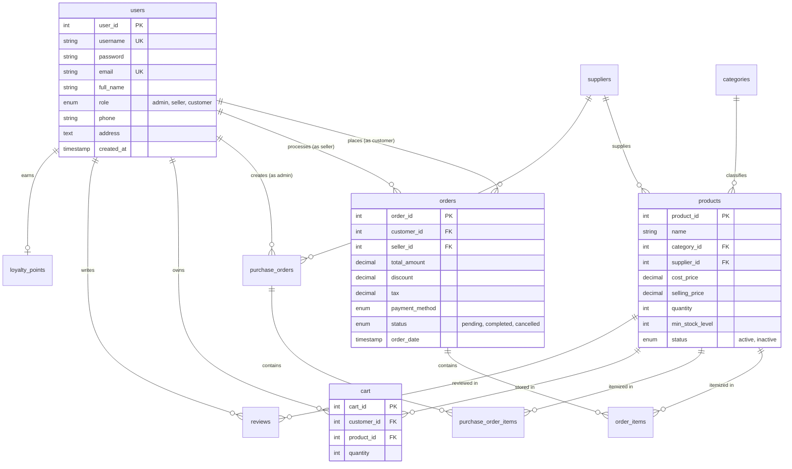

<div align="center">

  

  # 🛒 E-Shop Management System
  
  **A Comprehensive, Multi-Tier Role-Based E-Commerce & Inventory Platform**  
  *Designed & Developed for CSE311: Database Management Systems*

  <p align="center">
    
    
    
    
    
  </p>

  <p align="center">
    <a href="#-project-overview">Project Overview</a> •
    <a href="#-key-features--role-matrix">Key Features</a> •
    <a href="#-system-architecture">System Architecture</a> •
    <a href="#-database-schema--er-design">Database Schema</a> •
    <a href="#-demo-credentials">Demo Credentials</a> •
    <a href="#-installation--setup-guide">Installation</a> •
    <a href="#-directory-structure">Directory Structure</a>
  </p>

</div>

---

## 📖 Project Overview

**E-Shop** is a dynamic, full-featured web-based e-commerce and retail inventory management system created for the **CSE311: Database Management Systems** course. The project bridges database relational theory with real-world enterprise software, emphasizing robust relational schema modeling, foreign key constraints, transaction processing, and Role-Based Access Control (RBAC).

The system models a complete retail ecosystem with three primary stakeholder roles:
1. **System Administrator**: Oversees operations, manages suppliers, issues purchase orders, monitors finances, and analyzes sales reports.
2. **Seller / Merchant**: Manages product catalogs, monitors inventory thresholds, fulfills incoming orders, and tracks customer feedback.
3. **Customer**: Explores the storefront, manages a persistent shopping cart, places orders, tracks delivery status, earns loyalty rewards, and posts product reviews.

---

## 🌟 Key Features & Role Matrix

```
       ┌────────────────────────────────────────────────────────┐
       │             E-Shop Management Platform                 │
       └──────────────────────────┬─────────────────────────────┘
                                  │
         ┌────────────────────────┼────────────────────────┐
         ▼                        ▼                        ▼
  🛡️ Administrator         🏪 Seller / Merchant       🛒 Customer
  • User & Role Management • Product Catalog (CRUD) • Storefront & Search
  • Supplier Management    • Stock & Low-Stock Alerts• Cart Management
  • Purchase Orders (PO)   • Order Fulfillment      • Multi-Method Checkout
  • BI Sales Reports       • Customer Reviews       • Live Order Tracking
  • Profit & Loss Analysis • Direct Sales Entry     • Loyalty & Discounts
  • Campaigns & Loyalty                             • Profile & Reviews
```

### 🛡️ 1. Administrator Portal (`admin_dashboard.php`)
- **User & Access Control (`manage_user_roles.php`, `add_edit_users.php`)**: Create, update, deactivate accounts, and dynamically assign permissions (`admin`, `seller`, `customer`).
- **Supplier & Vendor Management (`add_update_suppliers.php`)**: Register commercial suppliers, maintain contact records, and govern procurement partnerships.
- **Procurement & Purchase Orders (`create_purchase_orders.php`, `track_product_procurement.php`)**: Generate purchase orders for low-stock items with supplier pricing and receipt status tracking.
- **Business Intelligence & Reporting**:
  - 📊 **Daily Sales Report (`daily_sales_report.php`)**: Real-time sales transactions, revenue aggregations, and hourly metrics.
  - 📅 **Weekly Sales Report (`weekly_sales_report.php`)**: Week-over-week growth trends and top-performing merchandise.
  - 📈 **Monthly Sales Report (`monthly_sales_report.php`)**: Comprehensive monthly financial summaries for executive audits.
  - 📦 **Inventory Usage Report (`inventory_usage_report.php`)**: Turnover rates and replenishment velocity.
  - 💰 **Profit & Loss Analysis (`profit_loss_analysis.php`)**: Granular margin analysis calculating revenue minus product cost price.
- **Promotions & Retention**:
  - **Discount Campaigns (`manage_discount_campaigns.php`)**: Configure time-bounded percentage and fixed-amount store discounts.
  - **Loyalty Program Engine (`create_loyalty_programs.php`)**: Grant points based on transaction totals to drive repeat retention.

---

### 🏪 2. Seller Portal (`seller_dashboard.php`)
- **Product Catalog Management (`manage_products.php`, `add_product.php`, `edit_product.php`)**: Add, modify, or archive items with category tags, cost price, retail price, and image URLs.
- **Stock Tracking & Threshold Alerts (`track_stock_levels.php`)**: Automated tracking of on-hand inventory with warnings whenever stock dips below `min_stock_level`.
- **Order Fulfillment (`view_orders.php`, `order_details_seller.php`)**: Monitor placed orders, view customer delivery details, and update shipment lifecycle stages.
- **Customer Feedback Monitoring (`all_reviews.php`)**: Read customer ratings (1–5 stars) and qualitative feedback to improve service quality.
- **Direct Sale Execution (`process_sale.php`)**: Process immediate walk-in or offline transactions directly from the seller console.

---

### 🛒 3. Customer Portal (`customer_dashboard.php`)
- **Dynamic Storefront (`browse_products.php`)**: Browse categorized items with live pricing, stock availability, and detailed descriptions.
- **Persistent Shopping Cart (`view_cart.php`, `add_to_cart.php`, `update_cart.php`, `remove_from_cart.php`)**: Add items to cart with live price calculations and quantity validation against current inventory.
- **Order Placement & Checkout (`checkout.php`)**: Select preferred payment methods (Cash on Delivery, Credit/Debit Card, Online) with automatic discount and tax calculations.
- **Order Tracking & History (`customer_order_history.php`, `track_order_status.php`)**: Track progress in real-time across states (`pending` ➔ `completed` ➔ `cancelled`).
- **Account & Security (`edit_profile.php`, `forgot_password.php`)**: Self-service profile management, address book updates, and password reset flows.
- **Reviews & Ratings**: Post feedback and rate purchased products to assist community buyers.

---

## 🏛️ System Architecture

The application adopts a classic **3-Tier Web Architecture**:



---

## 🗄️ Database Schema & ER Design

The database schema (`shop_management`) consists of **12 normalized relational tables** enforcing referential integrity via Foreign Key constraints.



### 📋 Database Tables Summary

| Table | Description | Key Relationships |
| :--- | :--- | :--- |
| `users` | Stores credentials, personal profiles, and role assignments (`admin`, `seller`, `customer`). | Referenced by `orders`, `cart`, `reviews`, `loyalty_points`, `purchase_orders`. |
| `suppliers` | Vendor directory with contact details, operational status, and address. | Referenced by `products` and `purchase_orders`. |
| `categories` | Categorization hierarchy for products (Electronics, Apparel, Home & Living, etc.). | Referenced by `products`. |
| `products` | Product inventory with cost/selling margins, quantity on hand, and alert thresholds. | References `categories` and `suppliers`. |
| `orders` | Customer order transactions, financial totals, discounts, taxes, and status. | References `users` (customer and seller). |
| `order_items` | Relational line items linking each order to specific products, prices, and quantities. | References `orders` and `products`. |
| `purchase_orders`| Procurement orders issued by Administrators to external suppliers. | References `suppliers` and `users` (admin). |
| `purchase_order_items` | Individual product procurement quantities and unit supplier costs. | References `purchase_orders` and `products`. |
| `cart` | Persistent user shopping carts ensuring unique product rows per customer. | References `users` and `products`. |
| `reviews` | Customer ratings (1–5) and written feedback per product. | References `users` and `products`. |
| `loyalty_points`| Accumulated customer reward points balance. | References `users`. |
| `promotions` | Discount marketing campaigns with validity dates and discount values. | Standalone ledger applied during checkout. |

---

## 🔑 Demo Credentials

The database script (`Shop_Management.sql`) automatically populates test accounts for immediate evaluation:

| Role | Username | Password | Purpose / Notes |
| :--- | :--- | :--- | :--- |
| **🛡️ Administrator** | `admin` | `CSE311.3E-Shop` | Full system control, reports, user roles & procurement |
| **🏪 Seller** | `rahim` | `48291` | Store merchant (StoreBD) with products & order management |
| **🏪 Seller** | `salma` | `19573` | Fashion merchant (FashionBD) |
| **🛒 Customer** | `akash` | `31472` | Standard customer account for cart & checkout testing |
| **🛒 Customer** | `rakib` | `76281` | Customer account with past order history |

> [!NOTE]  
> All sample passwords are preloaded in the SQL seed script. In production environments, passwords should always be hashed using PHP's `password_hash()` (Bcrypt / Argon2).

---

## 🛠️ Technology Stack

| Layer | Technologies Used |
| :--- | :--- |
| **Backend** | PHP 7.4 / 8.x (Session management, procedural & modular logic) |
| **Database** | MySQL 8.0+ / MariaDB via `mysqli` extension |
| **Local Server** | Apache HTTP Server via XAMPP |
| **Frontend** | HTML5, CSS3 (Role-tailored style sheets), Vanilla JavaScript |
| **Data Integrity** | Foreign Key constraints, Unique constraints, Cascading Rules |
| **Version Control** | Git & GitHub |

---

## 🚀 Installation & Setup Guide

Follow these steps to run the application locally on Windows using **XAMPP**:

### Prerequisites
- Install [XAMPP](https://www.apachefriends.org/) (with PHP 7.4 or higher and MySQL).
- Install [Git](https://git-scm.com/) (optional, or download as ZIP).

### Step 1: Clone or Copy the Repository
Clone the repository into your XAMPP web root directory (`C:\xampp\htdocs\`):

```bash
cd C:\xampp\htdocs
git clone https://github.com/MdRakibul726/E-Shop-CSE311.git
```

*(Alternatively, download the ZIP file and extract its contents into `C:\xampp\htdocs\E-Shop-CSE311\`)*.

### Step 2: Start Apache and MySQL
1. Open the **XAMPP Control Panel**.
2. Click **Start** for both **Apache** and **MySQL**.
3. Verify that the status indicators turn green.

### Step 3: Import the Database
1. Open your web browser and navigate to: `http://localhost/phpmyadmin/`
2. Click on **New** in the left sidebar to create a database.
3. Name the database **`shop_management`** and click **Create** (Collation: `utf8mb4_general_ci`).
4. Click on the newly created `shop_management` database.
5. Navigate to the **Import** tab at the top.
6. Click **Choose File** and select:
   ```
   C:\xampp\htdocs\E-Shop-CSE311\E-Shop\Information\Shop_Management.sql
   ```
7. Scroll to the bottom and click **Import** (or **Go**).
8. Verify that all 12 tables and initial seed data are populated successfully.

### Step 4: Verify Database Connection Configuration
Check `E-Shop/db_connect.php` to confirm credentials match your local MySQL server (defaults are preset for standard XAMPP):

```php
$servername = "localhost";
$username = "root";       // Default XAMPP username
$password = "";           // Default XAMPP password (blank)
$dbname = "shop_management";
```

### Step 5: Launch the Application
Open your browser and navigate to the login portal:
```
http://localhost/E-Shop-CSE311/E-Shop/login.php
```
Log in using any of the accounts listed in the [Demo Credentials](#-demo-credentials) section!

---

## 📁 Directory Structure

```plaintext
E-Shop-CSE311/
├── E-Shop/
│   ├── Information/                           # Project documentation & database dumps
│   │   ├── Shop_Management.sql                # Complete schema & sample datasets
│   │   ├── Project-Proposal.pdf               # Academic proposal & functional specs
│   │   ├── PHP File List.docx                 # Module architectural breakdown
│   │   └── admin - CSE311.3E-Shop.txt         # Admin credentials memo
│   │
│   ├── Logo/                                  # Branding & graphics
│   │   ├── Logo.png                           # App logo
│   │   └── Logo Name.png                      # App brand title asset
│   │
│   ├── Admin_Styles.css                       # Admin dashboard stylesheet
│   ├── Seller_Styles.css                      # Seller interface stylesheet
│   ├── Customer_Styles.css                    # Customer storefront stylesheet
│   ├── LSF_Styles.css                         # Login, Signup & Forgot password stylesheet
│   │
│   ├── db_connect.php                         # Centralized MySQL database connection
│   ├── login.php                              # Authentication & role router
│   ├── signup.php                             # Customer registration
│   ├── logout.php                             # Session termination
│   ├── forgot_password.php                    # Password recovery module
│   ├── edit_profile.php                       # User profile management
│   │
│   ├── # 🛡️ Administrator Modules
│   ├── admin_dashboard.php                    # Main Admin control hub
│   ├── add_edit_users.php                     # User account creation & edits
│   ├── manage_user_roles.php                  # RBAC role assigning
│   ├── add_update_suppliers.php               # Vendor management
│   ├── create_purchase_orders.php             # Supplier procurement orders
│   ├── track_product_procurement.php          # Supply chain monitoring
│   ├── manage_discount_campaigns.php          # Storewide promotions
│   ├── create_loyalty_programs.php            # Reward points management
│   ├── daily_sales_report.php                 # Daily sales reporting
│   ├── weekly_sales_report.php                # Weekly revenue analytics
│   ├── monthly_sales_report.php               # Monthly accounting summaries
│   ├── inventory_usage_report.php             # Inventory movement reports
│   ├── profit_loss_analysis.php               # Gross margin & profit/loss audit
│   │
│   ├── # 🏪 Seller Modules
│   ├── seller_dashboard.php                   # Seller overview & metrics
│   ├── manage_products.php                    # Product catalog listing
│   ├── add_product.php                        # Add new item to catalog
│   ├── edit_product.php                       # Update item specifications & pricing
│   ├── add_update_delete_products.php         # Product modification handlers
│   ├── manage_product_categories.php          # Category hierarchy setup
│   ├── track_stock_levels.php                 # Low stock notifications
│   ├── view_orders.php                        # Orders awaiting fulfillment
│   ├── order_details_seller.php               # Order breakdown for sellers
│   ├── process_sale.php                       # Point-of-sale direct entry
│   │
│   ├── # 🛒 Customer Modules
│   ├── customer_dashboard.php                 # Customer hub
│   ├── browse_products.php                    # Storefront product grid
│   ├── view_cart.php                          # Live shopping cart
│   ├── add_to_cart.php                        # Add product to cart
│   ├── update_cart.php                        # Cart quantity modifier
│   ├── remove_from_cart.php                   # Remove item from cart
│   ├── checkout.php                           # Order finalization & payment
│   ├── customer_order_history.php             # Past orders list
│   ├── order_history.php                      # Order log view
│   ├── order_details_customer.php             # Order invoice & details
│   ├── track_order_status.php                 # Live shipping status
│   └── all_reviews.php                        # Product reviews & ratings
│
└── README.md                                  # Repository documentation
```

---

## 🔒 Security & Data Integrity Highlights

1. **Role-Based Access Control (RBAC)**:  
   Each PHP controller performs session-level verification (`$_SESSION['role']`) to prevent privilege escalation or unauthorized URL access across roles.
2. **Referential Integrity**:  
   Foreign keys with `ON DELETE` and `ON UPDATE` rules ensure that orphaned order items, cart items, or review rows cannot exist without valid parent entities.
3. **Inventory Consistency**:  
   Real-time stock checks prevent customers from purchasing items exceeding current inventory counts.
4. **Clean Session Teardown**:  
   `logout.php` handles explicit session destruction (`session_unset()` & `session_destroy()`) to prevent session fixation.

---

## 🔮 Future Enhancements & Roadmap

- [ ] **Modern Cryptographic Security**: Migrate plain passwords to `password_hash()` with Bcrypt/Argon2id and implement prepared statements (`PDO` / parameter binding) throughout all endpoints.
- [ ] **Payment Gateway Integration**: Integrate live payment webhooks (e.g., bKash, Nagad, SSLCommerz, Stripe).
- [ ] **RESTful API Layer**: Provide JSON endpoints for potential Flutter / React Native mobile applications.
- [ ] **Automated Invoicing**: Generate dynamic PDF invoices upon checkout using libraries like Dompdf or TCPDF.
- [ ] **UI Modernization**: Upgrade custom CSS to Tailwind CSS or Bootstrap 5 for enhanced mobile responsiveness.

---

## 👨‍💻 Author

**MD. Rakibul Hasan**  
*Department of Computer Science & Engineering*  
- **GitHub**: [@MdRakibul726](https://github.com/MdRakibul726)  
- **Course**: CSE311 — Database Management Systems  
- **Location**: Dhaka, Bangladesh  

---

<div align="center">
  <sub>Built with ❤️ for CSE311: Database Management Systems. Star ⭐ the repository if you found it useful!</sub>
</div>
